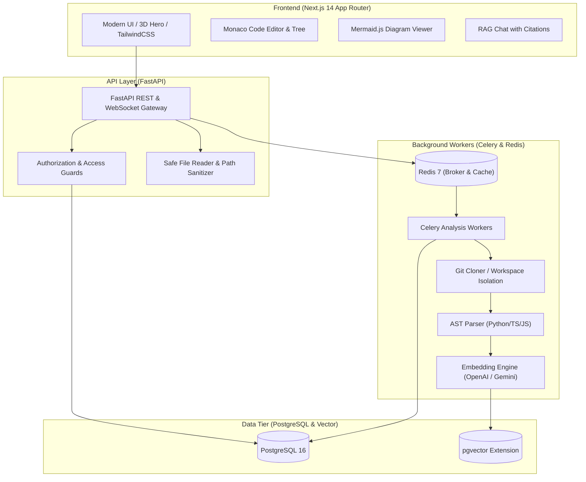

<div align="center">

# ⚡ RepoWiki AI

### Autonomous Codebase Intelligence, Living Architecture Diagrams & AI Wiki Engine

[](https://nextjs.org/)
[](https://fastapi.tiangolo.com/)
[](https://github.com/pgvector/pgvector)
[](https://docs.celeryq.dev/)
[](https://www.docker.com/)
[](LICENSE)

<p align="center">
  <b>RepoWiki AI</b> transforms complex codebases into interactive living documentation, dynamic architectural flowcharts, AST-detected API catalogs, and citation-grounded conversational assistants.
</p>

[Key Features](#-key-features) •
[Architecture](#-system-architecture) •
[Quickstart](#-quickstart-with-docker) •
[Local Development](#-manual-local-development) •
[API Reference](#-api-endpoints) •
[Environment Variables](#-configuration)

</div>

---

## 🚀 Key Features

<table>
  <tr>
    <td width="50%">
      <h3>🔍 Deep AST Code Analysis</h3>
      <ul>
        <li>Automated AST parsing for <b>Python</b> and <b>TypeScript/JavaScript</b> via Tree-sitter.</li>
        <li>Automatic extraction of classes, functions, decorators, parameters, and docstrings.</li>
        <li>Automatic discovery of REST endpoints (FastAPI, Flask, Express) with HTTP methods, route handlers, and line numbers.</li>
      </ul>
    </td>
    <td width="50%">
      <h3>🗺️ Dynamic Architecture & Diagrams</h3>
      <ul>
        <li>On-the-fly <b>Mermaid.js</b> system flowcharts and module relationship diagrams.</li>
        <li>Visual database Schema / ERD generator from ORM models.</li>
        <li>Dependency graph analysis and code flow visualizations.</li>
      </ul>
    </td>
  </tr>
  <tr>
    <td width="50%">
      <h3>💬 Citation-Validated RAG Chat</h3>
      <ul>
        <li>Context-aware conversational agent with strict repository multi-tenant isolation.</li>
        <li>Prompt injection defenses and secret redaction (AWS keys, tokens, SSH private keys).</li>
        <li>Responses backed by clickable file links and exact source code line citations.</li>
      </ul>
    </td>
    <td width="50%">
      <h3>📖 Living Wiki & Multi-Format Exports</h3>
      <ul>
        <li>On-demand AI Wiki covering architectural overviews, core concepts, and developer guides.</li>
        <li>Export complete wiki documentations to standalone <b>Markdown</b>, structured <b>JSON</b>, or presentation-ready <b>PDF</b> (via WeasyPrint).</li>
      </ul>
    </td>
  </tr>
  <tr>
    <td width="50%">
      <h3>💻 In-Browser IDE & Code Viewer</h3>
      <ul>
        <li>Embedded <b>Monaco Editor</b> with syntax highlighting and instant file navigation.</li>
        <li>One-click AI code explanations for any file or selected function.</li>
        <li>Traversal-safe streaming with file size guards and binary detection.</li>
      </ul>
    </td>
    <td width="50%">
      <h3>🔒 Enterprise-Grade Security & Auth</h3>
      <ul>
        <li>Public repositories freely accessible without login; private repos strictly protected.</li>
        <li>Existence-leaking prevention (returns <code>404 Not Found</code> instead of <code>403</code> for private assets).</li>
        <li>OAuth support for GitHub and Google authentication.</li>
      </ul>
    </td>
  </tr>
</table>

---

## 🏗️ System Architecture



---

## ⚡ Quickstart with Docker

The fastest way to spin up the entire RepoWiki AI stack (Frontend, API, PostgreSQL with pgvector, Redis, and Celery Worker):

### Prerequisites
- [Docker](https://docs.docker.com/get-docker/) & [Docker Compose](https://docs.docker.com/compose/)
- An OpenAI or Gemini API key

### 1. Clone the repository
```bash
git clone https://github.com/paraspathania/repowiki-ai.git
cd repowiki-ai
```

### 2. Configure environment variables
```bash
cp .env.example .env
```
Edit `.env` and add your `OPENAI_API_KEY`:
```env
OPENAI_API_KEY=sk-proj-your-api-key-here
```

### 3. Launch with Docker Compose
```bash
docker compose up --build -d
```

### 4. Access the services
- **Frontend Web Application**: [http://localhost:3000](http://localhost:3000)
- **Interactive OpenAPI Docs (Swagger)**: [http://localhost:8000/api/v1/docs](http://localhost:8000/api/v1/docs)
- **API Health Check**: [http://localhost:8000/health](http://localhost:8000/health)

---

## 🛠️ Manual Local Development

If you prefer running services outside Docker containers:

### 1. Start Infrastructure (PostgreSQL & Redis)
```bash
docker compose up -d postgres redis
```

### 2. Backend Setup (FastAPI & Celery)
```bash
# Enter backend directory
cd backend

# Create and activate virtual environment
python -m venv venv
# Windows:
.\venv\Scripts\activate
# macOS/Linux:
# source venv/bin/activate

# Install dependencies
pip install -r requirements.txt

# Run database migrations
alembic upgrade head

# Start FastAPI server
uvicorn app.main:app --host 0.0.0.0 --port 8000 --reload
```

In a separate terminal, run the Celery worker:
```bash
cd backend
celery -A app.workers.celery_app worker --loglevel=info -Q repository-analysis,parsing,embeddings,ai-generation,exports
```

### 3. Frontend Setup (Next.js 14)
```bash
cd frontend

# Install Node modules
npm install

# Run development server
npm run dev
```
Open [http://localhost:3000](http://localhost:3000) in your browser.

---

## 🧪 Testing

### Backend Unit & Integration Tests
RepoWiki AI includes a comprehensive automated test suite covering AST parsing, authorization guards, path traversal security, and RAG isolation:

```bash
# From the repository root
python -m pytest backend/tests -v
```

### Frontend Production Build & Type Checking
```bash
cd frontend
npm run build
```

---

## 📡 API Endpoints

| Method | Path | Description | Access Policy |
|---|---|---|---|
| `GET` | `/health` | Health check endpoint | Public |
| `POST` | `/api/v1/repositories/analyze` | Submit GitHub repository for ingestion & analysis | Public / Authenticated |
| `GET` | `/api/v1/repositories/{repo_id}/summary` | Repository overview metrics, tech stack, LOC | Public / Owner-only for private |
| `GET` | `/api/v1/repositories/{repo_id}/files` | Hierarchical file explorer tree | Public / Owner-only for private |
| `GET` | `/api/v1/repositories/{repo_id}/files/content` | Safe file content streaming (guards against `..` traversal) | Public / Owner-only for private |
| `GET` | `/api/v1/repositories/{repo_id}/apis` | Detected REST endpoints and route mappings | Public / Owner-only for private |
| `GET` | `/api/v1/repositories/{repo_id}/diagrams` | Dynamic Mermaid.js system architecture flowcharts | Public / Owner-only for private |
| `GET` | `/api/v1/repositories/{repo_id}/wiki` | Lazy-generated markdown wiki chapters | Public / Owner-only for private |
| `POST` | `/api/v1/chat/messages` | RAG codebase assistant query with citation verification | Public / Owner-only for private |
| `POST` | `/api/v1/exports` | Export wiki to PDF, Markdown, or JSON | Public / Owner-only for private |

---

## ⚙️ Configuration

Key environment settings defined in `.env`:

| Variable | Default | Purpose |
|---|---|---|
| `POSTGRES_SERVER` | `localhost` / `postgres` | Database host |
| `POSTGRES_PORT` | `5432` | PostgreSQL port |
| `POSTGRES_DB` | `repowikidb` | Database name |
| `REDIS_URL` | `redis://localhost:6379/0` | Redis instance for caching & Celery broker |
| `SECRET_KEY` | `dev-secret-key...` | JWT token signature secret |
| `LLM_PROVIDER` | `openai` | Primary LLM provider (`openai` or `gemini`) |
| `OPENAI_API_KEY` | - | OpenAI API credential |
| `OPENAI_STANDARD_MODEL`| `gpt-4o-mini` | Model for chunking, summaries & route analysis |
| `OPENAI_ADVANCED_MODEL`| `gpt-4o` | Model for deep wiki synthesis & complex RAG |
| `EMBEDDING_PROVIDER` | `openai` | Vector embedding provider (`openai` or `gemini`) |
| `OPENAI_EMBEDDING_MODEL`| `text-embedding-3-small` | Model for pgvector code embeddings |
| `NEXT_PUBLIC_API_URL` | `http://localhost:8000/api/v1`| Backend URL consumed by frontend |

---

## 🛡️ Security & Privacy

- **Safe Workspace Boundaries**: File streaming checks strictly enforce canonical path root containment to prevent directory traversal (`../../etc/passwd`).
- **Secret Redaction**: Code chunkers automatically redact high-entropy tokens, AWS keys, GitHub PATs, and private cryptographic keys before embedding or passing to LLMs.
- **Prompt Injection Hardening**: System prompts employ structured citation tags and delimiter boundaries to resist user-injected system instructions embedded within scanned code.
- **Repository Isolation**: Vector queries mandate `repository_id` filters to eliminate multi-tenant leakage across codebases.

---

## 📄 License

This project is licensed under the **MIT License** — see the [LICENSE](LICENSE) file for details.